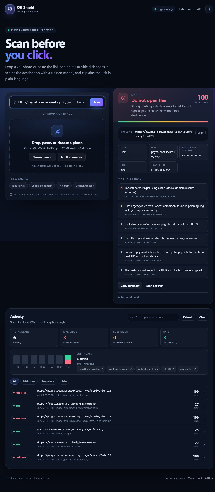
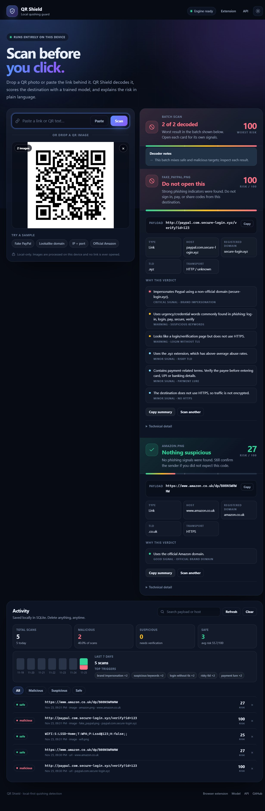
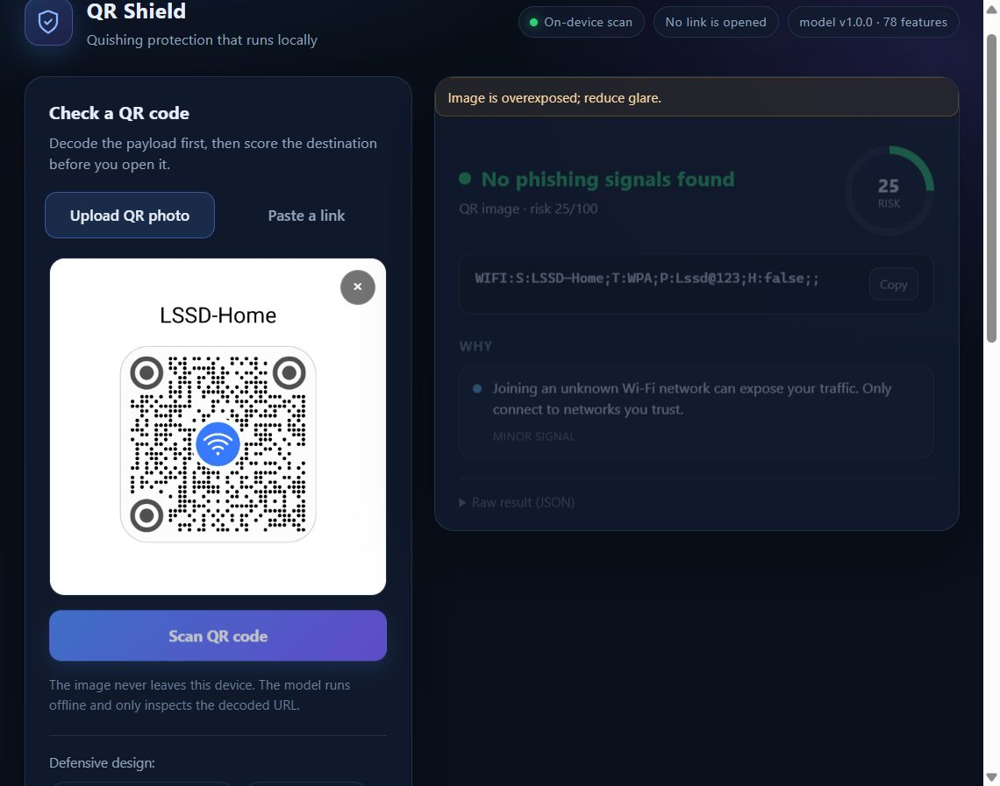
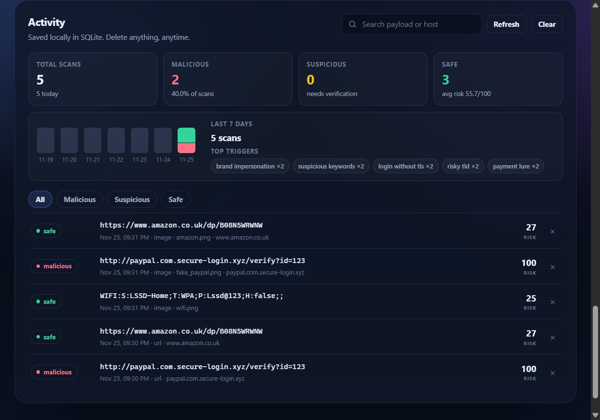
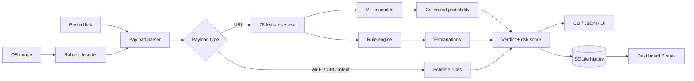

# QR Shield

**Local-first quishing (QR phishing) detection with a calibrated ML model and
explainable rules.**

[](https://github.com/Santhosh20collab/Qr-Shield-/actions/workflows/ci.yml)
[](pyproject.toml)
[](tests)
[](LICENSE)
[](docs/EVALUATION.md)
[](docs/EVALUATION.md)

QR codes hide their destination. QR Shield decodes the image, shows you what
the payload actually is, and scores the destination **before anything opens**.
It never fetches the link, never runs the payload, and keeps all history on your
machine.



## Highlights

- **Robust decoding** — blur, rotation, perspective, glare, low light, JPEG
  artifacts, small codes, and multiple codes per image (11/11 distortion
  benchmark).
- **Trained model** — calibrated blend of character/word TF-IDF logistic
  regression and histogram gradient-boosted trees over 78 URL features.
  **0.984 F1** on a domain-disjoint test set, **0.977 F1** on a temporal
  external holdout, **0.36% false-positive rate**.
- **Explainable** — every verdict includes rule-level reasons, model attention
  tokens, and numeric feature contributions. No black box.
- **Full payload coverage** — URLs, bare domains, nested redirects, Wi-Fi joins,
  UPI/crypto payments, `tel:`/`sms:`/`mailto:`, Android intents, and dangerous
  `javascript:`/`data:` schemes.
- **CLI + API + dashboard** — single and batch scanning, JSON/CSV reports,
  meaningful exit codes, searchable SQLite history, live statistics, and a
  7-day trend chart.
- **Production-shaped** — 58 tests, ruff, coverage, CI across four Python
  versions, non-root Docker image with healthcheck, model card, architecture
  and evaluation docs.

## Quick start

```powershell
git clone https://github.com/Santhosh20collab/Qr-Shield-.git
cd Qr-Shield-

python -m pip install -r requirements.txt

# The trained model ships in artifacts/. Optional: rebuild it from raw data
# python scripts/download_data.py
# python scripts/prepare_data.py
# python scripts/train_model.py --n-jobs 8

# Scan a link
python -m qrshield url "https://www.paypal.com/signin"

# Scan a QR image
python -m qrshield scan artifacts/demo_qr.png

# Open the dashboard
python -m qrshield serve --port 8000
```

Or install the package and use the `qrshield` entry point:

```powershell
python -m pip install -e ".[dev]"
qrshield url "http://paypal.com.secure-login.xyz/verify"
```

## Screenshots

| Malicious result | Batch QR scan |
|---|---|
|  |  |

Non-URL payloads are handled too — here a Wi-Fi join code from a phone photo
that OpenCV could not decode:





## How it works



The model is a weighted blend of a linear model over character/word n-grams and
a gradient-boosted tree model over structural features, calibrated on a
validation split. The rule engine adds auditable signals for brand
impersonation, raw IP hosts, non-standard ports, `user@host` credentials,
nested URLs, risky TLDs, shorteners, and social-engineering keywords. See
[`docs/ARCHITECTURE.md`](docs/ARCHITECTURE.md) for the full design.

## Model performance

Trained on 688k URLs from PhiUSIIL, Phishing Army, Tranco, and official brand
pages. Splits are **grouped by registrable domain**, so no host appears in two
splits; a test enforces this in CI. The external holdout uses later live feeds
and unseen Tranco domains.

| Split | Accuracy | Precision | Recall | F1 | FPR |
|---|---|---|---|---|---|
| Validation | 0.9897 | 0.9924 | 0.9753 | 0.9838 | 0.35% |
| Test | 0.9898 | 0.9926 | 0.9761 | **0.9843** | **0.36%** |
| External holdout | 0.9878 | 0.9869 | 0.9678 | **0.9773** | **0.48%** |

| Live-feed check | Result |
|---|---|
| OpenPhish (70 URLs) | 92.9% flagged malicious |
| Phishing Army external (10,123) | 96.8% flagged malicious |
| Tranco holdout (27,407 benign) | 0.48% false positives |

ROC-AUC is **0.9995** on test and **0.9994** on external. Full per-threshold
metrics, confusion matrices, calibration, and error analysis are in
[`docs/EVALUATION.md`](docs/EVALUATION.md) and
[`artifacts/metrics.json`](artifacts/metrics.json).

| Runtime | Value |
|---|---|
| Model size / load | 4.54 MB / 1.82 s |
| Single URL inference | 3.96 ms mean, 5.67 ms p95 |
| Batch inference | ~5,350 URLs/s |
| QR decode benchmark | 11/11 distortions, 0.26 s mean |

## CLI

```powershell
qrshield url "https://paypa1.com/login"          # analyse a link
qrshield scan photo.png                          # decode + analyse a QR image
qrshield batch samples/ --csv report.csv         # scan a folder of images
qrshield batch samples/ --fail-on malicious      # exit 1 if anything is malicious
qrshield history --stats                         # local scan statistics
qrshield history --verdict malicious --limit 20  # filter history
qrshield history --clear                         # delete all history
qrshield info                                    # model metadata + metrics
qrshield serve --port 8000                       # web app
```

Global flags go before the subcommand:

```powershell
qrshield --no-history scan private.png           # don't store this scan
qrshield --model path/to/model.joblib url ...    # use another artifact
```

All commands accept `--json` (where applicable) for scripting. Exit codes:
`0` safe/allowlisted, `1` suspicious, malicious, undecodable, or a batch that
matches `--fail-on`.

## Web app and API

```powershell
python -m qrshield serve --port 8000
# http://127.0.0.1:8000  ·  interactive docs at /docs
```

| Method | Endpoint | Purpose |
|---|---|---|
| GET | `/api/health` | liveness, model-loaded flag, uptime |
| GET | `/api/info` | version, limits, model metadata |
| POST | `/api/scan` | one image (`multipart/form-data`, field `file`) |
| POST | `/api/scan-batch` | up to 20 images with per-file errors |
| POST | `/api/scan-url` | `{"url": "..."}` |
| POST | `/api/scan-url/batch` | `{"urls": ["...", ...]}` |
| GET | `/api/history` | paginated history, `verdict`, `q` filters |
| GET | `/api/history/{id}` | full stored result |
| DELETE | `/api/history/{id}` | delete one row |
| DELETE | `/api/history` | clear all history |
| GET | `/api/stats` | totals, 7-day buckets, top reasons and hosts |

```powershell
curl -X POST http://127.0.0.1:8000/api/scan-url `
  -H "Content-Type: application/json" `
  -d '{"url":"http://paypal.com.secure-login.xyz/verify"}'
```

Images are processed in memory and never stored. The UI writes all untrusted
values with `textContent`, and responses carry `no-store`, `nosniff`, `DENY`
framing, and `no-referrer` headers. See [`SECURITY.md`](SECURITY.md).

## Verdicts

| Verdict | Meaning |
|---|---|
| `safe` | No meaningful phishing signal |
| `allowlisted` | Domain is in `allowlist.txt` and the payload is not dangerous |
| `suspicious` | Real warning signs, but not conclusive; verify before opening |
| `malicious` | Strong evidence of phishing, impersonation, or a dangerous payload |
| `unknown` | No URL to score (plain text, contact card, …) |

Thresholds (`suspicious` 0.33135, `malicious` 0.6627) are chosen on validation
data and stored in the artifact, so CLI, API, and UI always agree.

## What the rules catch

- **Brand impersonation** — brand in a non-official domain or subdomain
  (`paypal.com.secure-login.xyz`), lookalike spellings (`paypa1`, `arnazon`),
  punycode/homoglyph hosts.
- **Structural red flags** — raw IP hosts, non-standard ports, `user@host`
  credentials, embedded/nested URLs, open-redirect parameters, excessive
  subdomains, long or high-entropy hosts, risky TLDs.
- **Shorteners and free hosting** — warned about, but not called malicious on
  their own.
- **Content manipulation** — urgency/credential keywords, HTTP login pages,
  payment terms, obfuscated encoding.
- **Non-URL payloads** — Wi-Fi joins, `tel:`/`sms:`, `mailto:`, payment URIs
  (UPI/bitcoin), Android intents, and `javascript:`/`data:` schemes. Dangerous
  schemes are always malicious.
- **Nested redirects** — a URL inside a URL is decoded and scored; the maximum
  risk wins.

Official brand domains (`paypal.com`, `amazon.co.uk`, …) are recognized and
suppressed as impersonation, so legitimate login pages do not get flagged.

## QR decoding

Decoding is deliberately aggressive because phone photos are noisy:

1. Original, 2× upscale, CLAHE, adaptive threshold, Otsu, sharpened, inverted.
2. 90°/180°/270° rotations when the first pass finds nothing.
3. Mask each decoded code and rescan for additional codes in the frame.
4. Overlapping tiles for images with multiple codes.
5. ZXing-C++ on every variant, which decodes glossy screenshots and overexposed
   phone photos that OpenCV can only detect but not read.
6. Optional WeChat QR models for curved/low-contrast photos.

Drop the four WeChat model files into `artifacts/wechat/` to enable step 5; see
[`artifacts/wechat/README.md`](artifacts/wechat/README.md). Everything works
without them.

```powershell
python scripts/benchmark_qr.py
# writes artifacts/reports/qr_decode_benchmark.json
```

## Data pipeline

| Source | Role |
|---|---|
| [PhiUSIIL](https://archive.ics.uci.edu/dataset/967/phiusiil+phishing+url+dataset) | labelled phishing/benign URLs |
| [Phishing Army](https://phishing.army/) | fresh phishing domains |
| [Tranco](https://tranco-list.eu/) | popular benign domains |
| [OpenPhish](https://openphish.com/) | live feed used only for external testing |

`scripts/prepare_data.py`:

- groups all URLs by registrable domain **before** splitting, so no domain leaks
  across train/validation/test;
- augments benign Tranco domains with realistic paths and query strings;
- augments phishing domains with mixed schemes and campaign-style paths;
- adds official-brand benign pages and up-weights them so brand names are not
  treated as phishing by themselves;
- keeps external holdout domains disjoint from every training domain.

## Docker

```powershell
docker compose up --build
# http://127.0.0.1:8000
```

The image runs as a non-root user, mounts the model read-only, persists SQLite
history on a volume, and includes a healthcheck against `/api/health`. See
[`Dockerfile`](Dockerfile) and [`docker-compose.yml`](docker-compose.yml).

## Configuration

| Setting | Purpose |
|---|---|
| `allowlist.txt` | trusted hosts/domains/URL prefixes, one per line; `#` comments |
| `QR_SHIELD_MODEL` | path to an alternative `.joblib` artifact |
| `QR_SHIELD_DB` | path to the SQLite history database (default `data/qrshield.db`) |
| `artifacts/wechat/` | optional WeChat detector models |

Allowlisted domains are still flagged if the payload uses a dangerous scheme.

## Project layout

```
qrshield/
  features.py     78 URL features + text normalisation
  brands.py       official domains, risky TLDs, shorteners, keywords
  qr_decode.py    multi-variant OpenCV/ZXing QR decoding
  scanner.py      verdicts, rules, explanations, allowlist
  model.py        ensemble inference, calibration, explanations
  history.py      SQLite history and dashboard statistics
  cli.py          url / scan / batch / history / info / serve
app/
  main.py         FastAPI app and JSON endpoints
  static/         vanilla HTML/CSS/JS interface
scripts/
  download_data.py, prepare_data.py, train_model.py
  benchmark_qr.py, model_benchmark.py
tests/            58 tests: features, scanner, decoder, model, API, CLI,
                  history, split integrity
docs/             architecture, evaluation, resume kit, screenshots
artifacts/        trained model, metrics, benchmark reports
```

## Testing and quality

```powershell
python -m pytest -q
python -m pytest --cov=qrshield --cov=app --cov-report=term-missing
python -m ruff check qrshield app scripts tests
```

The suite covers feature extraction, brand/lookalike detection, scanner
verdicts, non-URL payloads, allowlist matching, QR decoding (clean, rotated,
blurred, multiple codes, blank images), model inference, API contracts, CLI
exit codes, history storage, and domain-disjoint splits. Model-dependent tests
skip automatically if the artifact is missing.

CI runs lint, tests, coverage, and wheel/sdist builds on Python 3.9–3.12. A
scheduled **Data integrity** workflow rebuilds the splits from the public feeds
and runs the domain-leak test against the full dataset.

## Documentation

- [`MODEL_CARD.md`](MODEL_CARD.md) — intended use, training data, metrics,
  limitations, ethics.
- [`docs/ARCHITECTURE.md`](docs/ARCHITECTURE.md) — components, scan flow,
  scoring, API, data model, design decisions.
- [`docs/EVALUATION.md`](docs/EVALUATION.md) — methodology, per-split results,
  calibration, error analysis, latency.
- [`docs/RESUME.md`](docs/RESUME.md) — resume bullets, STAR stories, interview
  questions, demo script.
- [`SECURITY.md`](SECURITY.md) — threat model, security properties, deployment
  checklist.

## Limitations

- **Static analysis only.** The URL is never fetched. A clean URL can still host
  malware, and a benign URL can redirect to a phishing page.
- **Bare root domains are hard.** All test false positives and 98% of false
  negatives are root domains with no path, where URL text carries little
  signal. Treat those verdicts as lower-confidence.
- **Badly damaged QR codes may not decode.** The UI reports this instead of
  guessing.
- **Temporal drift.** Phishing domains are short-lived; retrain periodically
  with fresh feeds.
- **No authentication.** The web app is for local or trusted-network use. Put
  it behind TLS and an authenticating proxy if exposed.

## Safety

QR Shield never opens, requests, or executes a decoded payload. URLs are parsed
as text, dangerous schemes are reported rather than run, uploads are bounded,
SQL is parameterised, and the UI escapes all untrusted output. History is
local-only and can be disabled with `--no-history` or cleared from the CLI/UI.

## License

MIT — see [`LICENSE`](LICENSE).
