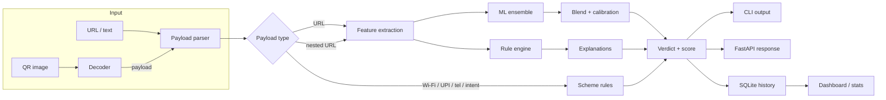

# Architecture

QR Shield is a local-first quishing detector. Every scan follows the same
pipeline, whether it starts from an image upload, a CLI command, or a pasted
link.



## Components

| Module | Responsibility |
|---|---|
| `qrshield/qr_decode.py` | Multi-variant OpenCV + ZXing decoding, rotations, tiling, multi-code masking, optional WeChat models |
| `qrshield/features.py` | URL parsing, 78 numeric features, brand/lookalike detection, text normalisation |
| `qrshield/brands.py` | Official brand domains, risky TLDs, shorteners, keyword lists |
| `qrshield/model.py` | Artifact loading, ensemble inference, calibration, token/numeric explanations |
| `qrshield/scanner.py` | Payload classification, rule scoring, verdict assembly, allowlist, nested URLs |
| `qrshield/history.py` | SQLite schema, record/list/delete/clear, 7-day aggregates, top reasons/hosts |
| `qrshield/cli.py` | `url`, `scan`, `batch`, `history`, `info`, `serve` commands |
| `app/main.py` | FastAPI routes, validation, security headers, history recording |
| `app/static/` | Vanilla HTML/CSS/JS single-page UI |

## Scan flow

### 1. Decode

`scan_image` accepts bytes, a path, a NumPy array, or a PIL image. The decoder
tries a sequence of pre-processing variants:

1. Original, 2× upscale, CLAHE, adaptive threshold, Otsu, sharpened, inverted.
2. 90°/180°/270° rotations if the first pass finds nothing.
3. Mask each decoded code and rescan the frame to find additional codes.
4. Overlapping tiles for busy images with several codes.
5. ZXing-C++ across the same variants, for glossy screenshots and overexposed
   photos that defeat OpenCV's decoder.
6. Optional WeChat detector for curved or low-contrast photos.

Each attempt is timed and recorded, so the UI can show which strategy succeeded.
Decoding failures return `ok: false` with an actionable error instead of a
guessed verdict.

### 2. Parse

The decoded payload is classified before any URL handling:

- `http` / `https` — normal URL path.
- `javascript:`, `data:`, `file:`, `vbscript:` — always malicious.
- `bitcoin:`, `ethereum:`, `upi:` — payment URI; scored with payment rules.
- `WIFI:` — network join; checked for open/weak encryption.
- `tel:`, `sms:`, `mailto:` — contact actions; low risk unless combined with
  social-engineering text.
- Plain text / vCard / calendar — no URL to score, returns `unknown` with a
  preview.

Bare domains (`paypal.com/login`) are normalised to `https://` for scoring, but
the original payload is preserved for display.

### 3. Score

Two independent scorers run and their outputs are merged:

**ML ensemble**

```
char TF-IDF ─┐
word TF-IDF ─┼─► LogisticRegression ─┐
78 numeric ──┘                       ├─► 0.6·linear + 0.4·HGB ─► Platt ─► p
78 numeric ─────► HistGradientBoosting┘
```

The model probability is calibrated, so `0.66` means roughly a 66% chance of
phishing on data like the training distribution.

**Rule engine**

Rules are grouped by severity and capped so a single noisy signal cannot
dominate:

| Severity | Weight | Example |
|---|---|---|
| critical | 0.90 | `javascript:` payload, brand impersonation with login path |
| high | 0.62 | raw IP host, `user@host`, punycode brand lookalike |
| medium | 0.42 | risky TLD, open redirect parameter, HTTP login page |
| low | 0.15 | link shortener, free hosting, excessive subdomains |
| info | 0.02 | contextual notes |
| positive | 0.00 | official brand domain, allowlist match |

The rule score is combined with the model score, and allowlisted or official
domains can suppress impersonation rules. The final verdict uses the artifact's
thresholds (`suspicious` 0.33135, `malicious` 0.6627).

### 4. Explain

Each result carries:

- `reasons[]` — code, severity, message, and weight for every triggered rule;
- `features` — the numeric URL features and human-readable highlights;
- `tokens` — the linear model's most influential character/word n-grams;
- `numeric_contributions` — the largest standardized feature contributions.

The UI renders these as a risk breakdown, not a black-box score.

### 5. Persist

Successful scans are written to SQLite (`data/qrshield.db`) with source, file
name, payload, host, verdict, score, probability, reasons, and the full JSON.
Writes happen in a threadpool and never fail the scan. `--no-history` disables
recording for a CLI invocation.

## API design

| Method | Path | Purpose |
|---|---|---|
| GET | `/api/health` | liveness, model-loaded flag, uptime |
| GET | `/api/info` | version, limits, model metadata |
| POST | `/api/scan` | one image (`multipart/form-data`, field `file`) |
| POST | `/api/scan-batch` | up to 20 images, per-file errors isolated |
| POST | `/api/scan-url` | `{"url": "..."}` |
| POST | `/api/scan-url/batch` | `{"urls": ["...", ...]}` (max 20) |
| GET | `/api/history` | paginated history, filter by verdict, search `q` |
| GET | `/api/history/{id}` | full stored result |
| DELETE | `/api/history/{id}` | delete one row |
| DELETE | `/api/history` | clear all history |
| GET | `/api/stats` | totals, 7-day buckets, top reasons and hosts |

Validation rules:

- Images: `image/*` or `application/octet-stream`, non-empty, ≤ 12 MB.
- URLs: non-empty, ≤ 4096 characters.
- Batches: ≤ 20 items; invalid images become per-item errors, not whole-request
  failures.
- `Cache-Control: no-store` on every response; `nosniff`, `DENY` framing, and
  `no-referrer` headers.

The UI and CLI share the same history database, so a scan from either surface
appears in the dashboard.

## Data model

```sql
CREATE TABLE scans (
    id            INTEGER PRIMARY KEY AUTOINCREMENT,
    created_at    TEXT    NOT NULL,   -- UTC ISO-8601
    source        TEXT    NOT NULL,   -- url | image
    filename      TEXT,
    payload       TEXT    NOT NULL,
    payload_type  TEXT,
    url           TEXT,
    host          TEXT,
    verdict       TEXT    NOT NULL,
    score         REAL    NOT NULL,
    probability   REAL,
    decode_method TEXT,
    reasons       TEXT,               -- JSON array
    result_json   TEXT                -- full scan result
);
CREATE INDEX idx_scans_created ON scans(created_at DESC);
CREATE INDEX idx_scans_verdict ON scans(verdict);
```

WAL mode and `synchronous=NORMAL` keep concurrent reads fast. All queries are
parameterised. Payload and reasons are truncated (`2048` / `20` entries) to
bound database growth.

## Design decisions

**Why local-first?** Submitting a suspicious URL to a third-party reputation
service leaks the fact that the user scanned it, and often the URL's
parameters. Local inference avoids that and works offline.

**Why an ensemble?** Character n-grams capture spelling tricks and obfuscation;
numeric features capture structure (IP hosts, ports, depth); gradient boosting
captures non-linear interactions. Blending all three outperformed any single
model on the validation split.

**Why domain-grouped splits?** Random splits leak near-duplicate URLs and
inflate accuracy. Grouping by registrable domain gives honest numbers and is
enforced by a test.

**Why rules in addition to ML?** Rules are auditable and deterministic. When a
user asks "why was this flagged?", a rule gives a concrete reason; the model
gives a probability. Combining them improves both trust and recall.

**Why SQLite?** Zero configuration, single file, easy backup, and good enough
for a local tool. It also makes the dashboard work without a separate service.

**Why vanilla JS?** No build step, no node_modules, and the whole UI is a few
hundred lines. That keeps the project easy to run and review.

## Performance

Measured on Windows 10, Python 3.9, 8 logical cores
([`artifacts/reports/model_benchmark.json`](../artifacts/reports/model_benchmark.json)):

| Operation | Result |
|---|---|
| Model load | 1.82 s |
| Single URL inference | 3.96 ms mean, 5.67 ms p95 |
| Batch inference | ~5,350 URLs/s |
| Full `scan_url` (model + rules) | 5.73 ms mean, 6.91 ms p95 |
| QR decode (11 distortions) | 11/11, 0.26 s mean |

QR decoding dominates end-to-end latency. The model itself is negligible.

## Deployment

```powershell
docker compose up --build
```

The container runs as a non-root user, exposes port 8000, and has a healthcheck
against `/api/health`. The trained model is mounted read-only; the SQLite
database lives on a writable volume so history survives restarts.

For production, put the app behind TLS (a reverse proxy), restrict network
access, and set `QR_SHIELD_DB` to a backed-up path. There is no authentication
by design: this is a local tool, not a multi-tenant service.
